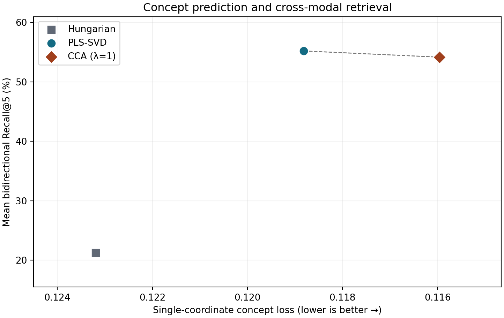

# CC3M SAE 대응 방법의 실제 데이터 평가

세 방법 모두 완료한 자료로 표와 그림을 작성했습니다. 남은 자료는 Visual Genome입니다.

2,905,954개의 CC3M 학습 쌍과 기존 이미지·텍스트 SAE를 사용했습니다. 헝가리안은 전체 일대일 할당에서 상관계수가 큰 256쌍을 사용했습니다. PLS-SVD와 규제 CCA는 각각 256개 조합을 사용했고, CCA의 규제 값은 1입니다. 세 방법 모두 후속 회전과 계수 절삭을 적용하지 않았습니다.



가로축은 COCO, COCO-Stuff의 이미지 개념 예측 손실 평균입니다. 낮을수록 오른쪽에 표시합니다. 세로축은 COCO, Flickr30k, DOCCI, IIW-400에서 두 방향 R@5를 같은 비중으로 평균한 값입니다.

| 대응 방법 | 그림의 개념 예측 손실 | 그림의 양방향 평균 R@5 (%) |
|---|---|---|
| Hungarian | 0.123197 | 21.256 |
| PLS-SVD | 0.118816 | 55.202 |
| CCA (λ=1) | 0.115963 | 54.158 |

## 개념 예측

손실, 혼합도, 분산도는 모두 낮을수록 좋습니다. CUB의 원본 속성 평가는 synCUB 편집 쌍에 사용할 분류기를 정하기 위해 별도로 측정했습니다.

| 자료 | 대응 방법 | 개념 수 | 개념 예측 손실 | 개념 혼합도 | 표현 분산도 |
|---|---|---|---|---|---|
| COCO | Hungarian | 80 | 0.101855 | 0.575565 | 0.56185 |
| COCO | PLS-SVD | 80 | 0.099984 | 0.746522 | 0.838061 |
| COCO | CCA (λ=1) | 80 | 0.09671 | 0.71757 | 0.81966 |
| COCO-Stuff | Hungarian | 171 | 0.144538 | 0.687106 | 0.616909 |
| COCO-Stuff | PLS-SVD | 171 | 0.137648 | 0.764508 | 0.829943 |
| COCO-Stuff | CCA (λ=1) | 171 | 0.135216 | 0.742649 | 0.816038 |
| CUB | Hungarian | 296 | 0.264324 | 0.780133 | 0.514349 |
| CUB | PLS-SVD | 296 | 0.254146 | 0.785304 | 0.84526 |
| CUB | CCA (λ=1) | 296 | 0.25479 | 0.775723 | 0.842063 |

## 이미지·캡션 검색

| 자료 | 대응 방법 | 이미지 R@1 (%) | 이미지 R@5 (%) | 이미지 R@10 (%) | 텍스트 R@1 (%) | 텍스트 R@5 (%) | 텍스트 R@10 (%) | 잘린 캡션 (%) |
|---|---|---|---|---|---|---|---|---|
| COCO | Hungarian | 5.36 | 13.28 | 19.6 | 4.082 | 11.07 | 16.319 | 0.0 |
| COCO | PLS-SVD | 20.5 | 41.24 | 51.72 | 14.308 | 31.546 | 42.096 | 0.0 |
| COCO | CCA (λ=1) | 20.66 | 41.22 | 52.18 | 14.012 | 30.663 | 40.677 | 0.0 |
| Flickr30k | Hungarian | 11.9 | 25.6 | 33.4 | 9.5 | 24.14 | 32.36 | 0.02 |
| Flickr30k | PLS-SVD | 37.6 | 64.2 | 74.3 | 31.62 | 60.02 | 71.18 | 0.02 |
| Flickr30k | CCA (λ=1) | 40.2 | 65.1 | 74.6 | 32.04 | 59.8 | 70.84 | 0.02 |
| DOCCI | Hungarian | 3.56 | 11.06 | 17.16 | 3.76 | 11.4 | 16.9 | 94.4 |
| DOCCI | PLS-SVD | 16.6 | 38.74 | 50.62 | 18.22 | 41.62 | 53.44 | 94.4 |
| DOCCI | CCA (λ=1) | 16.42 | 37.7 | 49.3 | 18.72 | 39.78 | 50.52 | 94.4 |
| IIW-400 | Hungarian | 17.5 | 37.25 | 45.75 | 17.25 | 36.25 | 48.25 | 99.0 |
| IIW-400 | PLS-SVD | 50.25 | 80.0 | 90.75 | 53.0 | 84.25 | 90.0 | 99.0 |
| IIW-400 | CCA (λ=1) | 49.0 | 77.75 | 88.25 | 51.25 | 81.25 | 90.0 | 99.0 |

이미지 R@5는 이미지로 정답 캡션을 상위 5개 안에서 찾은 비율입니다. 텍스트 R@5는 캡션으로 정답 이미지를 찾은 비율입니다.

## 편집 전후의 개념 예측 확률

한 건은 편집 전후의 이미지 한 쌍에서 개념 하나를 비교한 값입니다. 평균 확률 변화는 편집 후 확률에서 편집 전 확률을 뺀 값입니다. 예를 들어 −0.17이면 해당 개념의 예측 확률이 평균 17%p 낮아졌다는 뜻입니다.

| 자료 | 대응 방법 | 편집 역할 | 평가 건수 | 분류기 없는 건수 | 평균 확률 변화 | 평균 절대 확률 변화 |
|---|---|---|---|---|---|---|
| synCOCO | Hungarian | 제거 | 2504 | 0 | -0.17333 | 0.18881 |
| synCOCO | Hungarian | 유지 | 4691 | 0 | -0.00846 | 0.04455 |
| synCOCO | PLS-SVD | 제거 | 2504 | 0 | -0.14088 | 0.16286 |
| synCOCO | PLS-SVD | 유지 | 4691 | 0 | -0.01099 | 0.05006 |
| synCOCO | CCA (λ=1) | 제거 | 2504 | 0 | -0.16298 | 0.18378 |
| synCOCO | CCA (λ=1) | 유지 | 4691 | 0 | -0.01195 | 0.05736 |
| synCUB | Hungarian | 제거 | 2933 | 0 | -0.00881 | 0.01548 |
| synCUB | Hungarian | 추가 | 2933 | 0 | 0.00181 | 0.00408 |
| synCUB | Hungarian | 유지 | 92495 | 32 | -0.00242 | 0.00891 |
| synCUB | PLS-SVD | 제거 | 2933 | 0 | -0.04070 | 0.08194 |
| synCUB | PLS-SVD | 추가 | 2933 | 0 | 0.04571 | 0.05364 |
| synCUB | PLS-SVD | 유지 | 92495 | 32 | -0.01283 | 0.05123 |
| synCUB | CCA (λ=1) | 제거 | 2933 | 0 | -0.05262 | 0.09066 |
| synCUB | CCA (λ=1) | 추가 | 2933 | 0 | 0.04792 | 0.05876 |
| synCUB | CCA (λ=1) | 유지 | 92495 | 32 | -0.01553 | 0.05358 |

## 재현 방법

### 저장된 결과로 그림과 표를 다시 만들기

저장소의 [측정값](measurements.json)에는 각 방법과 자료에서 얻은 결과가 들어 있습니다. 표와 그림만 다시 만들 때는 GPU, SAE 가중치, 원본 데이터가 필요하지 않습니다. 저장소를 복제한 뒤 다음 명령을 실행합니다.

```bash
git clone https://github.com/JiH00nKw0n/mm-sae.git
cd mm-sae
python3 -m venv .venv-report
.venv-report/bin/python -m pip install numpy matplotlib
.venv-report/bin/python scripts/report_baselines.py \
  docs/baselines-2026-11-07/measurements.json docs/baselines-2026-11-07
```

### 원본 데이터부터 학습과 평가 실행하기

저장소 루트에서 Docker GPU 이미지를 빌드합니다. [벤치마크 입력 안내](../benchmarks.md)에 따라 원본 자료를 배치합니다. 아래에서 `/datasets/mm-sae`는 평가 자료, `/cache/mm-sae/cc3m`은 기존 CC3M 임베딩 캐시, `/checkpoints/cc3m/models`는 이미지·텍스트 SAE가 들어 있는 경로를 뜻합니다.

```bash
make build TARGET=gpu IMAGE=mm-sae:gpu
for method in hungarian pls cca; do
  make run TARGET=gpu IMAGE=mm-sae:gpu DATA=/datasets/mm-sae CACHE=/cache/mm-sae \
    RUNS=/results/mm-sae SAE=/checkpoints/cc3m/models \
    ARGS="run configs/paper.yaml --mapping configs/mapping/${method}.yaml"
done
```

위 명령은 저장된 SAE를 고정하고 대응 행렬을 학습한 뒤 평가합니다. `/results/mm-sae/paper/mappings/` 아래의 각 `fit.json`에 학습 데이터와 가중치의 식별값이 기록됩니다. 같은 폴더의 `evaluation` 아래에 데이터셋별 결과와 `summary.csv`가 저장됩니다.

개념 평가의 분할 시드는 0이며, 같은 이미지의 모든 문장은 하나의 분할에 둡니다. 표는 이 고정 분할에서 측정한 값입니다. 개념 평가에서는 조합·개념별 로지스틱 분류기를 학습하고, 이미지 단위로 분리한 검증 자료에서 개념마다 손실이 가장 낮은 조합을 선택합니다. 최종 손실은 고정한 조합의 평가 손실을 개념별로 평균합니다. 학습에 양성·음성 각각 20개 이상, 검증에 양성·음성 각각 1개 이상이 있는 개념을 사용합니다. 편집 평가에서는 선택한 분류기를 그대로 사용합니다. 검색은 각 데이터셋의 전체 후보로 계산하며 한 이미지의 정답 캡션을 모두 인정합니다. 이미지 질의와 텍스트 질의를 따로 보고합니다.

서버에서는 기존 COCO 활성값의 이미지 순서와 정답 주석의 이미지 ID를 대조해 재사용했습니다. 분류기의 목적함수는 단일 조합의 이진 교차엔트로피입니다. 서버 계산은 각 축의 점수 분포에서 레이블과 무관한 합을 GPU에서 수치 적분하고, 기울기가 급한 경우 원래 표본에서 직접 계산합니다. 최종 평가 손실은 원래 표본별 점수에서 직접 구합니다.

표와 그림은 세 방법의 결과 폴더를 읽어 다시 만듭니다. 저장소 루트에서 다음 명령을 실행합니다. 각 방법마다 동일한 데이터 분할의 실행 하나를 넣습니다.

```bash
docker run --rm --entrypoint python \
  -v "$PWD/scripts/report_baselines.py:/report.py:ro" \
  -v /results/mm-sae:/runs:ro \
  -v "$PWD/docs/baselines-2026-11-07:/report-out" \
  mm-sae:gpu /report.py /runs/paper /report-out
```

이 실행에서 CC3M 캐시 식별값은 `b7850d49907b85280057c956fb2cab391edbf64a56d21df956cc9fbf2d5d0920`입니다. 입력 인코더는 `openai/clip-vit-base-patch32`의 버전 `3d74acf9a28c67741b2f4f2ea7635f0aaf6f0268`을 사용했습니다. 입력 한도는 특수 토큰을 포함한 77개입니다. COCO-Stuff에서 세 방법의 36개 조합·개념 분류기를 저장소의 직접 계산 방식으로 대조했습니다. 검증 손실의 최대 절대 차이는 0.000000002 미만이었습니다.

개념 혼합도와 표현 분산도는 검증 손실이 학습 자료의 양성 비율만 사용하는 상수 분류기에 비해 얼마나 줄었는지로 계산합니다. 손실 감소량이 0보다 작으면 중요도를 0으로 둡니다. 한 조합의 중요도가 여러 개념에 퍼질수록 혼합도가 커집니다. 한 개념의 중요도가 여러 조합에 퍼질수록 분산도가 커집니다. 편집 전후 비교 표에서 제거한 개념은 확률의 감소, 추가한 개념은 확률의 증가, 유지한 개념은 작은 절대 변화를 기대합니다. CUB 원본 평가는 synCUB에 적용할 분류기를 선택하는 데 사용합니다.

실제 평가 자료의 출처는 다음과 같습니다.

| 자료 | 이 실행에서 사용한 입력 |
|---|---|
| COCO와 COCO-Stuff | COCO 2017의 instance 주석과 전체 이미지의 COCO-Stuff 164K 마스크를 사용했습니다. COCO 검색에서는 val2017의 이미지 5,000장과 캡션 25,014개를 사용했습니다. |
| Flickr30k | 공개 검색 시험 분할의 이미지 1,000장과 캡션 5,000개를 사용했습니다. [CLIP Benchmark의 시험 이미지](https://huggingface.co/datasets/clip-benchmark/wds_flickr30k)와 [원본 파일명·분할·캡션 목록](https://huggingface.co/datasets/nlphuji/flickr30k)을 캡션 집합으로 대조했습니다. |
| DOCCI | 공식 시험 설명과 이미지 ID를 사용했습니다. [이미지 배포본](https://huggingface.co/datasets/not-lain/docci)의 각 파일명과 설명을 [DOCCI 공식 자료](https://google.github.io/docci/)의 시험 ID 및 설명과 대조했습니다. |
| IIW-400 | [공식 IIW-400 주석](https://github.com/google/imageinwords/tree/main/datasets/IIW-400)의 사람 작성 설명과 해당 ID의 DOCCI-AAR 이미지를 사용했습니다. |
| Visual Genome | [공식 영역 그래프와 이미지 메타데이터](https://visualgenome.org/api/v0/api_home)를 사용합니다. 각 영역 문장에 명시한 주석만 양성으로 처리하고, 같은 이미지의 모든 문장을 같은 분할에 둡니다. 동일한 문장은 한 번 인코딩한 뒤 원래 표본 순서와 주석을 복구해 평가합니다. |
| CUB | CUB-200-2011의 원래 학습·시험 분할과 이미지별 속성 유무를 사용했습니다. [속성 주석 배포본](https://huggingface.co/datasets/Jaszczurix7652/CUB-200-2011)과 [이미지 배포본](https://huggingface.co/datasets/bentrevett/caltech-ucsd-birds-200-2011)을 파일명으로 연결했습니다. |
| synCOCO와 synCUB | [synCOCO v1.0](https://huggingface.co/datasets/jokl/syncoco/tree/v1.0)과 [synCUB v1.0](https://huggingface.co/datasets/jokl/syncub/tree/v1.0)의 편집 전후 이미지 및 개념 변화 주석을 사용합니다. |

[실행 식별값](provenance.json)에는 코드 커밋, 양쪽 SAE 가중치와 설정의 SHA-256, 세 대응 행렬의 SHA-256, 데이터 배포 버전을 기록했습니다. 그림에서 사용하는 평균은 연구자가 정한 요약 방식입니다. 데이터셋별 비교와 두 검색 방향의 차이는 본문의 세부 표에서 확인할 수 있습니다.

Visual Genome에서 문장별 물체·관계 주석을 읽었습니다. [주석 범위 집계](visual-genome-coverage.json)에서 평가 조건을 충족한 개념은 물체 5,430개와 관계 1,179개입니다. 이 자료를 읽는 방식에서는 별도 속성 주석이 0개였습니다. 전체 5,406,592개 문장 중 1,779,173개에는 읽어 낸 물체·관계 주석이 없습니다. 손실 계산에서 양성은 해당 주석이 문장에 연결된 경우이고, 나머지는 0입니다. 따라서 텍스트 점수는 이 주석을 예측하는 성능으로 해석해야 합니다.

자료별 학습·검증·평가 표본 수와 검색 후보 수는 [평가 표본 수](populations.csv)에 기록했습니다.
