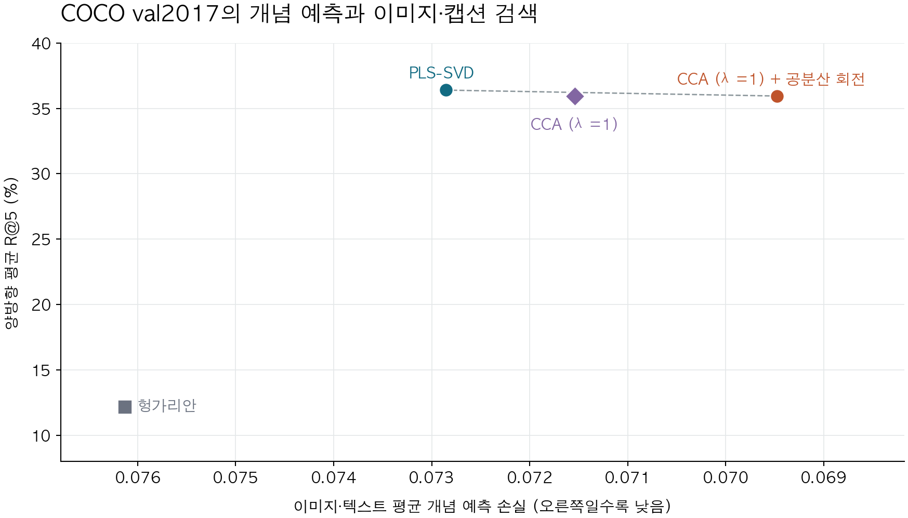

# COCO val2017에서 평가한 256좌표 대응 방법

공분산 회전을 적용하자 CCA의 이미지·텍스트 평균 개념 예측 손실은 0.07154에서 0.06948로 낮아졌고 양방향 평균 R@5는 35.94%로 같았습니다. PLS-SVD의 양방향 평균 R@5는 36.39%로 가장 높았습니다.

| 방법 | 평가 좌표 수 | 이미지 개념 손실 | 텍스트 개념 손실 | 평균 개념 손실 | 양방향 평균 R@5 |
|---|---:|---:|---:|---:|---:|
| 헝가리안 | 256 | 0.12320 | 0.02907 | 0.07613 | 12.17% |
| PLS-SVD | 256 | 0.11882 | 0.02689 | 0.07285 | 36.39% |
| CCA (λ=1) | 256 | 0.11596 | 0.02712 | 0.07154 | 35.94% |
| CCA (λ=1) + 공분산 회전 | 256 | 0.11469 | 0.02426 | 0.06948 | 35.94% |

이미지 손실은 COCO 물체 80개와 COCO-Stuff 물체·배경 171개의 자료별 평균을 같은 비중으로 합친 값입니다. 텍스트 손실은 COCO val2017과 겹치는 Visual Genome의 물체 170개와 관계 42개에서 측정했습니다. 가로축은 이미지 손실과 텍스트 손실의 평균입니다.

세로축은 이미지로 정답 캡션을 찾는 경우와 캡션으로 정답 이미지를 찾는 경우에 정답이 상위 5개에 든 비율을 평균했습니다. 점선은 이 네 방법 중 개념 손실과 검색 성능에서 동시에 앞서는 다른 방법이 없는 점들을 연결합니다.

회전은 이번 CCA 해에서 한 번 구했습니다. 10월의 해와 이번 해는 활성 특징 수가 달랐습니다. 회전은 최대 반복 500회에서 종료했습니다.

[그림에 사용한 원수치](measured-points.csv) · [평가 자료와 지표 정의](../baselines-2026-11-07/README.md)
