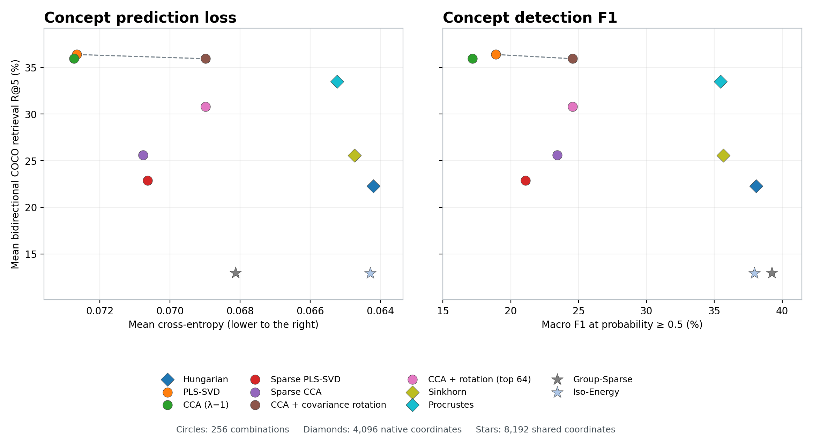

# SAE 활성값 32개를 기준으로 한 COCO val2017 평가

SAE는 이미지 한 장이나 캡션 하나를 입력받으면 원래 활성값 중 가장 큰 32개를 남긴다. 검색에서는 이 표현에 각 방법의 대응 행렬을 적용한 뒤 전체 출력 벡터의 코사인 유사도로 순위를 정한다. 반면 개념 예측에서는 출력 축 하나에 들어가는 계수를 절댓값 순으로 최대 32개만 남긴다. 학습할 때부터 계수가 최대 16개였던 희소 PLS-SVD와 희소 CCA는 그 계수를 그대로 쓴다.

| 방법 | 평가 좌표 수 | 예측 손실 | 정밀도 (%) | 재현율 (%) | F1 (%) | 양방향 검색 R@5 (%) |
|---|---:|---:|---:|---:|---:|---:|
| Hungarian | 4096 | 0.06420 | 53.45 | 32.96 | 38.09 | 22.27 |
| PLS-SVD | 256 | 0.07266 | 31.75 | 15.31 | 18.90 | 36.39 |
| CCA (λ=1) | 256 | 0.07274 | 27.58 | 14.10 | 17.19 | 35.94 |
| Sparse PLS-SVD | 256 | 0.07064 | 35.89 | 16.67 | 21.09 | 22.88 |
| Sparse CCA | 256 | 0.07077 | 38.06 | 19.14 | 23.44 | 25.62 |
| CCA + covariance rotation | 256 | 0.06899 | 39.14 | 20.01 | 24.57 | 35.94 |
| CCA + rotation (top 64) | 256 | 0.06899 | 39.14 | 20.01 | 24.57 | 30.81 |
| Sinkhorn | 4096 | 0.06474 | 51.19 | 30.49 | 35.67 | 25.57 |
| Procrustes | 4096 | 0.06524 | 52.31 | 29.70 | 35.45 | 33.49 |
| Group-Sparse | 8192 | 0.06813 | 59.07 | 32.59 | 39.25 | 12.97 |
| Iso-Energy | 8192 | 0.06429 | 53.69 | 32.65 | 37.94 | 12.91 |

[11개 방법의 결과표](comparison.csv) · [개념별 판정 건수](per-concept.csv) · [혼합도·분산도, 편집 반응, 네 자료의 양방향 검색](additional/README.md)

헝가리안, Procrustes, Sinkhorn은 독립적으로 학습한 이미지 SAE와 텍스트 SAE의 전체 4,096개 좌표를 사용한다. CC3M에서 분산이 0인 특징은 표준화한 값이 0이다. 전체 좌표에서 일대일 대응을 구하는 헝가리안은 텍스트 특징 순서를 바꾸고, Procrustes는 텍스트 벡터에 직교 변환을 적용한다. Sinkhorn은 이미지와 텍스트 좌표 사이의 연결 강도를 구해 정규화한 뒤 텍스트 벡터를 변환한다. 세 방법은 이미지 좌표를 그대로 쓰므로 이미지 쪽 개념 예측 결과가 같다. Group-Sparse와 Iso-Energy는 이미지와 텍스트가 함께 쓰는 SAE의 원래 좌표 8,192개에서 개념마다 하나를 고른다.

개념별로 검증 손실이 가장 작은 축을 선택하고 COCO val2017에 해당하는 평가 표본에서 손실과 정밀도·재현율·F1을 계산했다. 양성 판정 기준은 예측 확률 0.5 이상이다. 개념별 지표를 먼저 평균하고 COCO 물체 80개에 25%, COCO-Stuff 물체·배경 171개에 25%, Visual Genome의 물체·관계 212개에 50%의 비중을 두었다. 검색 R@5는 이미지 5,000장과 캡션 25,014개를 대상으로 이미지 질의와 캡션 질의 각각에서 정답이 상위 다섯 개에 든 비율을 구한 뒤 두 비율을 평균했다.

## 헝가리안 검색에서 좌표 수와 표준화의 영향

| 검색에 쓴 활성값 | 256쌍 양방향 R@5 | 전체 4,096쌍 양방향 R@5 |
|---|---:|---:|
| CC3M에서 구한 평균과 표준편차로 표준화 | 12.17% | 22.27% |
| 원래 SAE 활성값 | 11.00% | 33.14% |

기존 256쌍 모두가 전체 대응에 포함됐다. 표준화 전에 값이 0보다 큰 특징을 세면, 전체 좌표에서 이미지와 캡션 모두 표본당 평균 32개가 남았다. 256쌍에 한정하면 이미지당 평균 2.28개, 캡션당 평균 1.98개만 남았다. 두 조건의 검색 후보와 질의는 같다.

논문은 원래 활성값에 헝가리안 순열을 적용하고 코사인 유사도로 검색했다. 논문의 세 실행 평균 R@5는 이미지 질의 34.1%, 캡션 질의 27.2%였다. 이번 단일 실행에서 전체 4,096쌍의 원래 활성값을 쓰면 각각 38.44%, 27.84%였다. 논문 코드가 지정한 Karpathy test와 이번 COCO val2017은 평가 분할이 다르다. [논문 표 1](https://arxiv.org/html/2606.29888#S7.T1) · [논문의 검색 코드](https://github.com/JiH00nKw0n/lvlm_hallucination/blob/b09bd423cec3ff635f475e7750025fead0806fce/scripts/real_alpha/eval_coco_retrieval.py)
