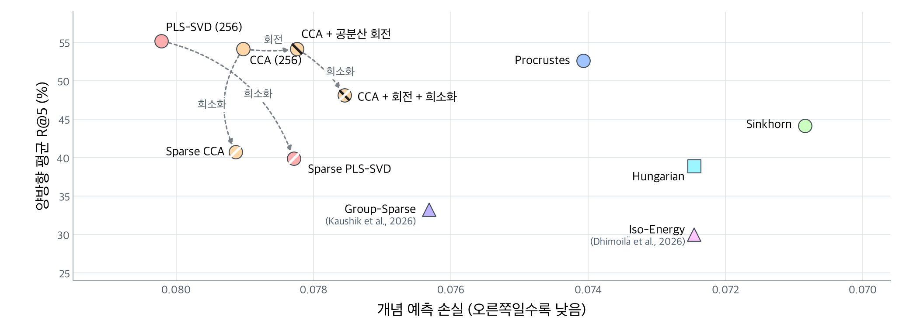
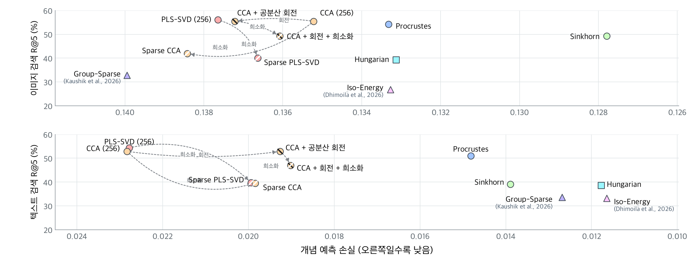

# 추가 계수 제한 없이 평가한 11개 방법

학습된 SAE와 대응 행렬을 고정하고, 개념 예측 평가에만 적용하던 최대 32개 계수 제한을 제거했다. 각 방법의 학습된 조합 점수를 그대로 사용한다. 희소 PLS-SVD와 희소 CCA의 원래 영 계수, CCA 회전 후 희소화 조건의 축당 64개 계수는 유지한다. SAE의 표본별 Top-k=32도 변경하지 않았다.

이미지는 COCO-Stuff의 물체·배경 171개, 텍스트는 COCO 이미지에 연결된 Visual Genome 영역 문장의 물체 170개를 평가했다. 기존 학습·검증·평가 분할을 유지했다. 각 개념에서 검증 손실이 가장 작은 단일 좌표를 고르고 평가 자료의 손실을 측정했다. 정밀도·재현율·F1은 예측 확률 0.5 이상을 양성으로 판정하여 개념별로 구한 뒤 평균했다.

헝가리안·Sinkhorn·Procrustes는 이미지를 텍스트 좌표로, 텍스트를 이미지 좌표로 옮긴 후 평가했다. PLS-SVD·CCA 및 그 변형은 256개 조합, 세 직접 대응 방법은 4,096개 좌표, 공유 SAE 두 방법은 8,192개 좌표를 사용했다.

## 이미지 개념 예측

| 방법 | 예측 손실 | 재현율 (%) | 정밀도 (%) | F1 (%) |
|---|---:|---:|---:|---:|
| Hungarian | 0.1331 | 23.9 | 53.8 | 29.9 |
| PLS-SVD (rank=256) | 0.1376 | 11.1 | 29.2 | 14.6 |
| CCA (λ=1, rank=256) | 0.1352 | 13.8 | 32.1 | 17.6 |
| Sparse PLS-SVD | 0.1366 | 18.0 | 45.6 | 23.5 |
| Sparse CCA | 0.1384 | 19.4 | 46.2 | 24.5 |
| CCA + 공분산 회전 | 0.1372 | 19.6 | 48.7 | 25.2 |
| CCA + 회전 + 희소화 | 0.1361 | 20.3 | 49.2 | 26.1 |
| Sinkhorn (ε=0.05) | 0.1278 | 25.1 | 50.1 | 31.0 |
| Procrustes | 0.1333 | 23.5 | 55.3 | 29.8 |
| Group-Sparse | 0.1399 | 21.0 | 57.3 | 27.9 |
| Iso-Energy | 0.1333 | 23.4 | 54.0 | 29.4 |

## 텍스트 개념 예측

| 방법 | 예측 손실 | 재현율 (%) | 정밀도 (%) | F1 (%) |
|---|---:|---:|---:|---:|
| Hungarian | 0.0118 | 42.4 | 53.9 | 46.3 |
| PLS-SVD (rank=256) | 0.0228 | 5.2 | 15.1 | 6.9 |
| CCA (λ=1, rank=256) | 0.0228 | 5.6 | 15.5 | 7.4 |
| Sparse PLS-SVD | 0.0199 | 13.4 | 26.0 | 16.6 |
| Sparse CCA | 0.0198 | 15.3 | 26.7 | 18.4 |
| CCA + 공분산 회전 | 0.0193 | 15.2 | 27.3 | 18.3 |
| CCA + 회전 + 희소화 | 0.0190 | 15.7 | 27.3 | 18.8 |
| Sinkhorn (ε=0.05) | 0.0139 | 33.5 | 44.3 | 37.1 |
| Procrustes | 0.0148 | 32.6 | 49.6 | 38.1 |
| Group-Sparse | 0.0127 | 44.8 | 60.7 | 50.4 |
| Iso-Energy | 0.0116 | 42.3 | 55.1 | 46.6 |

## 검색과 개념 예측의 관계

검색에는 원래 추가 계수 제한을 적용하지 않았으므로, 같은 가중치로 측정한 COCO·Flickr30K·DOCCI·IIW의 결과를 재사용했다. 각 자료의 양방향 R@5를 구한 뒤 네 자료에 같은 비중을 두어 평균했다. 그림의 개념 예측 손실은 이미지와 텍스트 평균에 같은 비중을 두어 계산했다.





## 재현 절차

저장소 최상위에서 다음 명령을 실행한다. 실험에 사용한 CC3M 가중치와 주석 캐시가 있는 경로를 `--work`에 지정한다. NVIDIA GPU와 CUDA용 PyTorch, Triton이 필요하다. 첫 번째 명령은 계수 제한을 제거하면서 입력이 바뀐 여섯 방법을 평가한다. 두 번째 명령은 나머지 다섯 방법의 검증된 개념별 결과와 네 벤치마크의 기존 검색 결과를 합쳐 11개 방법의 표를 만든다.

```bash
python scripts/frozen_concepts/evaluate.py --work /mnt/working/baseline-20261107 --output runs/frozen-uncapped
python scripts/frozen_concepts/report.py --output runs/frozen-uncapped
```

[평가 설정](../../../configs/report/frozen_uncapped.json)에는 두 자료의 개념 범위, 분할 식별값, 모달리티별 가중치 식별값, 재사용 방법을 기록했다. [학습 및 평가 기본 설정](../../../configs/coco_val2017_uncapped.yaml)에서 SAE의 표본별 활성값 수는 32이고, 학습된 조합을 평가할 때 적용하는 추가 계수 제한은 없다. 한 조건만 확인하려면 첫 명령에 `--method pls --dataset stuff`를 붙인다. 출력 경로는 각 조건을 처음 실행할 때 새로 만든다.

## 계산을 확인한 방법

기존 헝가리안의 순열은 전체 4,096개 좌표에서 일대일로 대응한다. 희소 PLS-SVD와 희소 CCA의 학습된 계수는 각 축에서 이미 최대 16개였다. 공유 SAE 두 방법은 대응 행렬을 거치지 않고 공유 좌표를 직접 사용한다. 이 다섯 방법은 제한 유무에 따라 입력 점수가 달라지지 않아 검증된 기존 평가값을 사용했다. 다른 여섯 방법은 저장된 학습 가중치에서 다시 평가했다.

개념 혼합도와 표현 분산도는 모든 좌표의 검증 손실로 계산했다. 검증 손실 행렬에서 개념별 최솟값을 구해 선택된 분류기의 기록과 대조했다. 모든 좌표의 곱셈과 수치 적분을 묶어 계산한 경로는 원래 분류기 구현으로 뽑은 좌표에서도 대조했다.

[모달리티별 개념 평가표](concept-summary.csv) · [혼합도와 분산도](mixing-dispersion.csv) · [검색과 개념 예측을 합친 표](summary.csv) · [평가 설정 및 검증 기록](verification.json)
