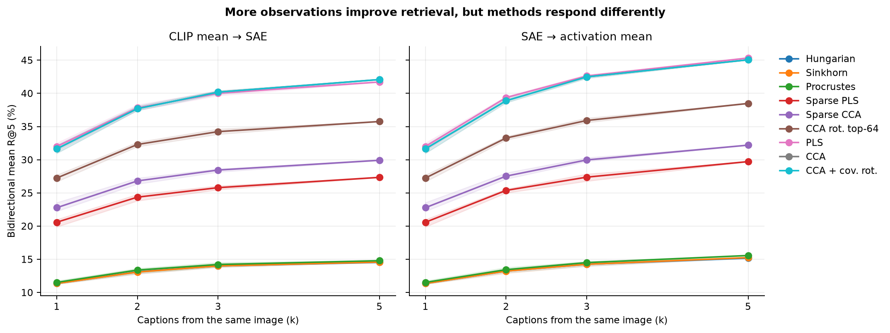
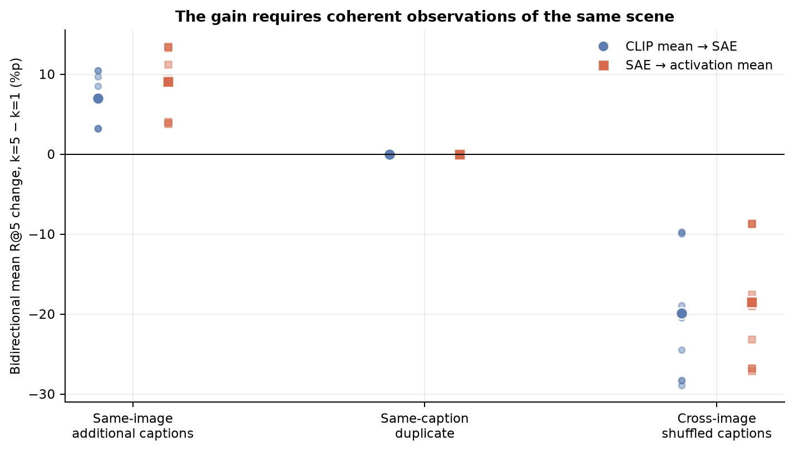
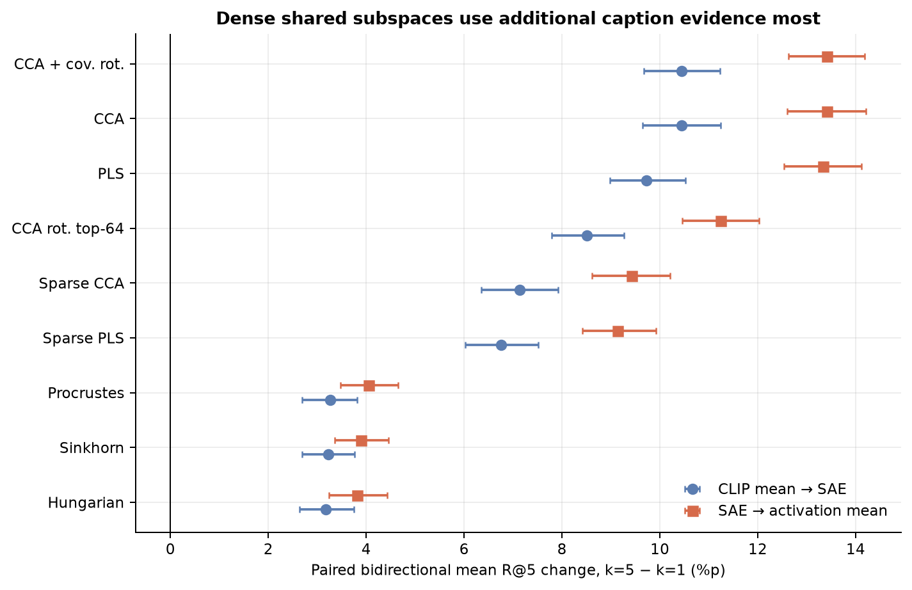

# Controlled Multi-Caption Observation Audit

## 요약

동일 이미지의 캡션을 1개에서 5개로 늘리면 9개 mapping 전체에서 retrieval이 개선됐다. 그러나 개선량은 dense > sparse > 1:1 순으로 달랐다.

따라서 단일 캡션의 부분 관측은 실제 공통 병목이지만, 기존 method gap을 없애지는 않는다. 현재 retrieval은 mapping 구조뿐 아니라 image와 caption이 실제로 공유한 정보량에도 영향을 받는다.

## 1. 문제

하나의 이미지는 여러 객체·배경·행동을 포함하지만, 개별 캡션은 그중 일부만 언급한다.

예를 들어 이미지가 `빨간 재킷을 입은 아이가 스케이트보드를 타고 있고, 옆에는 개와 여러 사람이 있는 장면`을 포함해도, 같은 이미지의 캡션들은 서로 다른 부분만 설명할 수 있다.

```text
A child is riding a skateboard.
A boy in a red jacket is outside.
A dog is standing next to a skateboarder.
```

각 캡션은 틀리지 않지만 이미지의 모든 정보를 담지는 않는다.

기존 COCO retrieval에도 이미지당 약 5개의 캡션이 있지만, 이들은 각각 독립된 text row로 사용된다. 여러 캡션이 언급한 complementary information을 하나의 text representation으로 합치지는 않는다.

따라서 현재 retrieval failure에는 두 원인이 섞여 있을 수 있다.

\[
\text{retrieval failure}
=
\text{mapping failure}
+
\text{partial observation}.
\]

이번 실험은 mapping과 SAE를 고정하고, 동일 이미지에서 사용하는 캡션 수만 바꾸어 두 원인을 분리한다.

## 2. 실험

새 캡션을 생성하거나 학습 데이터를 늘리지 않았다. COCO에 원래 존재하는 동일 이미지의 human caption 중 \(k\)개를 선택해 하나의 text-set representation으로 만들었다.

\[
k\in\{1,2,3,5\}.
\]

예를 들어 캡션별 CLIP embedding이 \(t_1,t_2,t_3\)라면 다음과 같이 통합한다.

\[
\bar t
=
\operatorname{normalize}
\left(
\frac{t_1+t_2+t_3}{3}
\right).
\]

이 평균이 이미지 의미의 정확한 합집합을 복원한다고 가정하지 않는다. 동일 장면에 대한 여러 부분 관측을 하나의 representation으로 요약했을 때 현재 mapping이 어떻게 반응하는지를 측정한다.

### 설정

- COCO val2017: 이미지 5,000장, 캡션 25,014개
- controlled retrieval: 5,000 images × 5,000 text sets
- \(k=1,2,3,5\)
- 10 seeds
- 독립 SAE 기반 mapping 9개
- paired hierarchical bootstrap 2,000회

모든 \(k\)에서 후보 수를 5,000개로 고정했다. 따라서 핵심 비교는 후보 수 변화가 아니라 동일 이미지의 text observation을 추가했을 때의 변화다.

### Aggregation

두 가지 통합 위치를 비교했다.

1. CLIP embedding을 평균한 뒤 SAE에 입력
2. 각 캡션의 SAE activation을 계산한 뒤 평균

\[
\operatorname{SAE}
\left(
\operatorname{mean}(t_j)
\right)
\quad\text{vs.}\quad
\operatorname{mean}
\left(
\operatorname{SAE}(t_j)
\right).
\]

### Controls

- Same-image: 같은 이미지의 서로 다른 캡션 추가
- Duplicate: 같은 캡션 반복
- Cross-image: 다른 이미지의 캡션 혼합

## 3. 결과

| 조건 | \(k=5-k=1\) 양방향 평균 R@5 |
|---|---:|
| Same-image captions | **+8.02%p** |
| Same-caption duplicate | **+0.00%p** |
| Cross-image captions | **−19.18%p** |

9개 mapping × 2개 aggregation 조건 모두에서 same-image 효과의 95% bootstrap CI가 0을 제외했다.

같은 캡션을 반복하면 per-query rank까지 정확히 같았다. 다른 이미지의 캡션을 섞으면 성능이 크게 악화됐다. 따라서 개선은 단순 averaging이나 smoothing이 아니라, 같은 장면에 대한 complementary observation을 추가한 효과다.





## 4. 방법별 차이

추가 caption evidence를 활용하는 정도는 mapping 구조에 따라 달랐다.

| 구조 | \(k=5-k=1\) 효과 |
|---|---:|
| 1:1 matched features | 약 +3~4%p |
| Sparse combinations | 약 +7~9%p |
| Dense CCA/PLS | 약 +10~13%p |

\[
\text{1:1}
<
\text{sparse}
<
\text{dense}.
\]



부분 관측은 모든 방법에 영향을 주지만, 추가 evidence를 retrieval 개선으로 바꾸는 능력도 mapping 구조에 따라 다르다.

또한 SAE activation을 먼저 계산한 뒤 평균하는 방식이 CLIP embedding을 먼저 평균하는 방식보다 일관되게 큰 효과를 보였다. Caption별 sparse evidence를 먼저 추출하면 complementary information이 더 잘 보존될 가능성을 시사한다.

## 5. Pareto 해석

이번 실험은 새 mapping을 제안하지 않았으므로 Pareto frontier를 직접 개선한 실험은 아니다.

- concept loss는 고정
- retrieval만 caption observation에 따라 변화

즉 각 방법의 점이 동일한 x 위치에서 수직으로 얼마나 움직이는지를 측정했다.

\[
\text{observed retrieval}
=
f(
\text{mapping structure},
\text{observed semantic overlap}
).
\]

Retrieval 자체는 여전히 유효한 결과 지표다. 다만 이를 순수한 mapping 품질로만 해석하면 안 된다. Caption coverage를 높여도 method gap은 사라지지 않았고 dense 방법이 더 크게 개선됐다. 따라서 기존 Pareto trade-off를 caption omission만으로 설명할 수는 없다.

이번 결과는 기존 Pareto에 각 방법의 observation sensitivity를 추가한다.

## 6. 방법론적 의미

기존 alignment는 image와 caption representation 전체가 대응한다고 가정한다.

\[
Mx_i \approx Ny_i.
\]

하지만 이미지에 `skateboard`, `dog`, `red jacket`이 있고 현재 캡션이 `skateboard`만 언급했다면, 나머지 variation은 mapping 실패가 아니라 미관측 상태일 수 있다.

따라서 후속 방법에서는 mapping뿐 아니라 sample과 feature별 observation reliability를 함께 검토할 필요가 있다.

\[
r_{id}
=
P(
\text{feature }d\text{가 sample }i\text{의 양쪽 모달리티에 관측됨}
).
\]

예를 들어 alignment loss를 다음처럼 구성할 수 있다.

\[
\mathcal L_{\mathrm{align}}
=
\sum_{i,d}
r_{id}
\,
\ell(z_{id}^{I},z_{id}^{T}).
\]

양쪽에 관측된 feature는 강하게 정렬하고, caption에서 관측되지 않은 image-private variation은 강제로 맞추지 않는다.

이번 결과가 특정 방법을 확정하는 것은 아니다. 다만 기존 mapping 확장과 함께 다음 설계축을 비교할 근거를 제공한다.

- sample/feature별 observation reliability
- shared/private variation
- caption별 sparse evidence를 보존하는 aggregation

## 7. 다음 단계

1. Sparse CCA anchor drift 원인 확인
2. Group-Sparse와 Iso-Energy checkpoint 복구
3. 11개 방법 전체에서 observation sensitivity 재확인
4. 단순 feature-reliability baseline과 기존 mapping 확장을 동일 조건에서 비교

새 방법의 성공 기준은 추가 캡션이 없는 \(k=1\)에서 실제 Pareto를 개선하는 것이다.

\[
\Delta \operatorname{retrieval}_{k=1}>0,
\qquad
\Delta \operatorname{concept\ loss}\le0.
\]

## 8. 한계

- Group-Sparse와 Iso-Energy가 포함되지 않았다.
- Sparse CCA의 11월 8일 anchor가 최대 1.30%p 드리프트했다.
- 다중 캡션은 diagnostic intervention이며 single-caption 환경의 직접적인 해결법이 아니다.
- 기존 Pareto의 정확한 좌표 이동으로 해석할 수 없다.
- CC3M single-caption mapping 학습 가정을 직접 변경하지 않았다.

## 결론

단일 캡션의 부분 관측은 실제 retrieval 병목이다. 그러나 이를 보완해도 기존 method gap은 남았고, dense shared subspace가 추가 evidence를 가장 잘 활용했다.

따라서 후속 연구에서는 “어떻게 더 잘 연결할 것인가”와 함께 “현재 sample에서 무엇이 실제로 양쪽에 관측됐는가”를 고려해야 한다.

